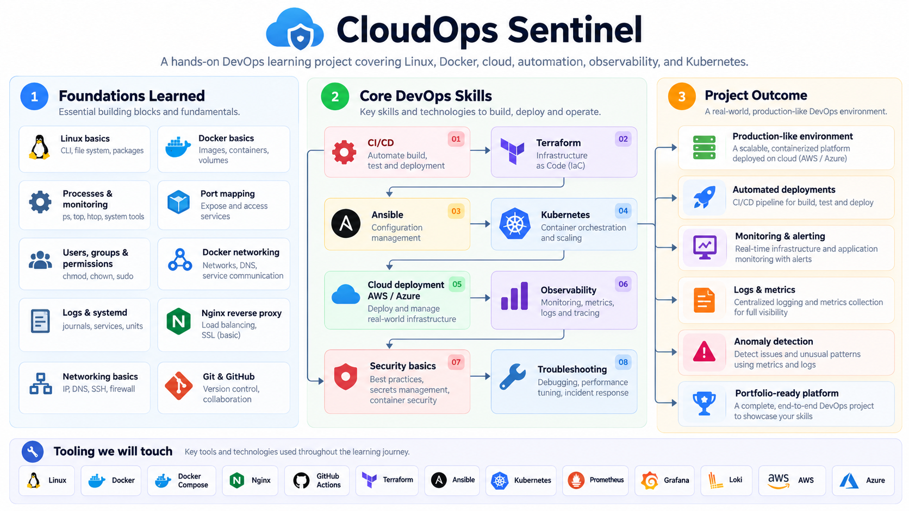

# CloudOps Sentinel

CloudOps Sentinel is a hands-on DevOps project focused on building, automating, deploying, and monitoring a production-like environment using Docker, Kubernetes, Terraform, Ansible, CI/CD, cloud platforms, and observability tools.

